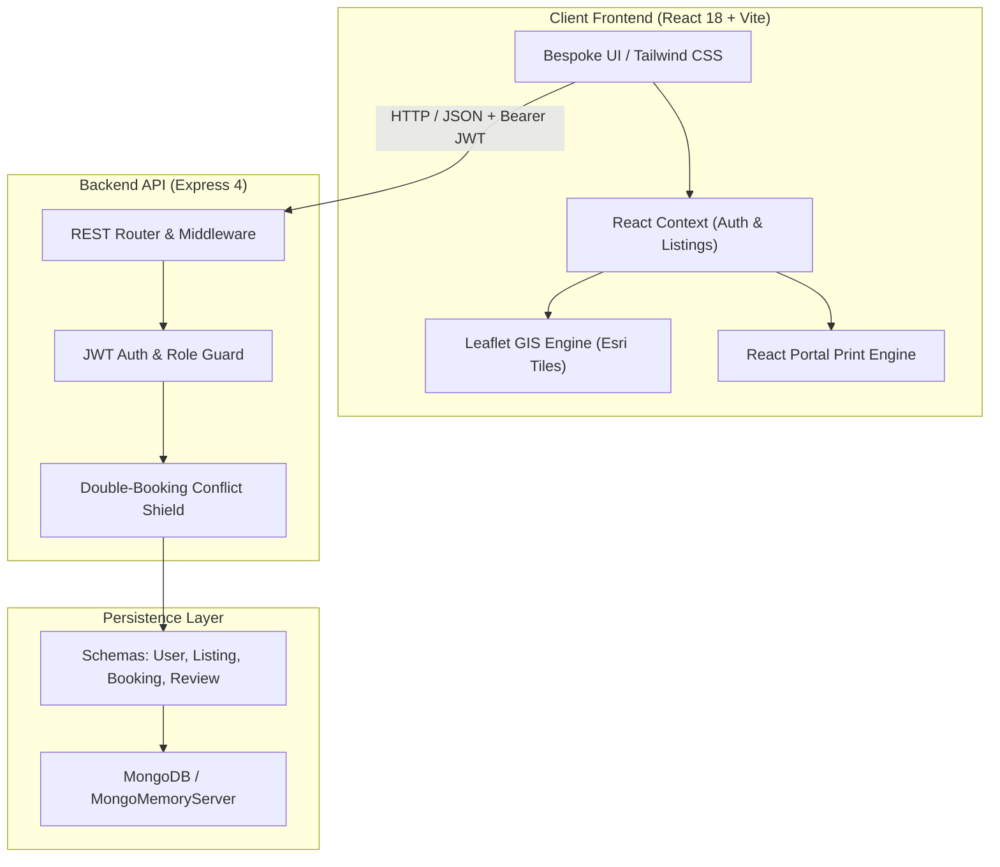

# Airbnb Clone — Enterprise Full-Stack Engineering Capstone

[](https://opensource.org/licenses/Apache-2.0)
[](https://react.dev/)
[](https://vitejs.dev/)
[](https://tailwindcss.com/)
[](https://nodejs.org/)
[](https://expressjs.com/)
[](https://mongoosejs.com/)
[](https://leafletjs.com/)
[](https://www.framer.com/motion/)
[](#-verification--shadow-run-suite)

An enterprise-grade, production-tested Full-Stack Airbnb Clone developed as an engineering capstone project. Engineered with a decoupled client-server architecture, atomic state management, geospatial map clustering, concurrency-safe reservation scheduling, and an executive-grade printable itinerary receipt engine.

---

## 🚀 Production Live URLs

- **Live Application (Frontend)**: [https://airbnb-clone-enterprise.vercel.app](https://airbnb-clone-enterprise.vercel.app)
- **Production API Server (Backend)**: [https://airbnb-backend-api-wiks.onrender.com](https://airbnb-backend-api-wiks.onrender.com)
- **API Health Check**: [https://airbnb-backend-api-wiks.onrender.com/api/health](https://airbnb-backend-api-wiks.onrender.com/api/health)

---

## 👨‍💻 Author & Engineering Profile

- **Author**: Ranadeep Saha
- **Email**: [ranadeep2021saha@gmail.com](mailto:ranadeep2021saha@gmail.com)
- **LinkedIn**: [linkedin.com/in/ranadeep-saha-a03296404](https://www.linkedin.com/in/ranadeep-saha-a03296404)
- **Repository**: [github.com/unknown404-practice/airbnb-clone-enterprise](https://github.com/unknown404-practice/airbnb-clone-enterprise)

---

## 🌟 Architectural Highlights



- **Concurrency-Safe Double-Booking Shield**: Strict overlap validation (`checkIn < existing.checkOut && checkOut > existing.checkIn`) blocking collision bookings with HTTP 409.
- **Geospatial Map Exploration**: Custom Leaflet integration with Esri World Street Map tiles, interactive price pill markers, dynamic card synchronization, and responsive split-screen view.
- **Executive Print & Receipt Engine**: Background iframe-isolated print engine rendering a structured tax itinerary and payment receipt with zero blank-page artifacts in Chromium.
- **Role-Based Portals**: Seamless host and guest role toggling with dedicated analytics dashboards, listing managers, and trip timelines.
- **Zero-Config Database Fallback**: Built-in `MongoMemoryServer` fallback allowing immediate offline execution without local MongoDB installation prerequisites.

---

## 🔑 Demo Personas & Credentials

The database automatically seeds 16 luxury properties and 4 demo accounts:

| Role | Email | Password | Persona & Capabilities |
|---|---|---|---|
| **Guest** | `sophia@traveller.io` | `password123` | Sophia Chen — Verified traveler with active bookings, past trips, and saved wishlists. |
| **Guest** | `julian@wanderlust.com` | `password123` | Julian Hayes — Standard traveler profile for clean reservation flows. |
| **Host** | `host@luxuryretreats.com` | `password123` | Elena Rostova — Superhost managing 8 luxury properties, occupancy KPIs, and incoming reservations. |
| **Host** | `marcus@archdesign.com` | `password123` | Marcus Vance — Architectural host with active design properties. |

---

## ⚙️ Quickstart Guide

### 1. Clone the Repository
```bash
git clone https://github.com/unknown404-practice/airbnb-clone-enterprise.git
cd airbnb-clone-enterprise
```

### 2. Environment Configuration
Environment files are strictly isolated from source control. Copy the provided templates:

```bash
# Server environment
cp server/.env.example server/.env

# Client environment
cp client/.env.example client/.env
```

### 3. Install Dependencies
```bash
# Install server dependencies
cd server && npm install

# Install client dependencies
cd ../client && npm install
cd ..
```

### 4. Launch Services

Run both servers in separate terminal windows:

**Terminal 1 — Backend API Server:**
```bash
npm run dev:server
# Or: cd server && node src/server.js
```
*API will start on `http://localhost:5000` with embedded MongoDB auto-seeding.*

**Terminal 2 — Frontend Client:**
```bash
npm run dev:client
# Or: cd client && npm run dev
```
*Client will open on `http://localhost:5173` with instant Hot Module Replacement.*

---

## 🧪 Verification & Shadow-Run Suite

A comprehensive 18-point integration dry-run test suite is included in [`server/src/scripts/shadowRunBackend.js`](server/src/scripts/shadowRunBackend.js).

Execute the test suite at any time:
```bash
npm run test:backend
# Or: node server/src/scripts/shadowRunBackend.js
```

### Automated Test Matrix (100% Pass)
```text
====================================================
   AIRBNB CLONE BACKEND SHADOW RUN TEST SUITE       
====================================================
[PASS] 1. GET / (API Root)
[PASS] 2. GET /api/health (System Health)
[PASS] 3. GET /api/auth/login (Auth Info)
[PASS] 4. POST /api/auth/login (Guest Auth)
[PASS] 5. POST /api/auth/login (Host Auth)
[PASS] 6. POST /api/auth/login (Invalid Password)
[PASS] 7. GET /api/auth/me (JWT Verification)
[PASS] 8. GET /api/listings (All Stays)
[PASS] 9. GET /api/listings?category=Beachfront
[PASS] 10. GET /api/listings?search=Kyoto
[PASS] 11. GET /api/listings/:id
[PASS] 12. GET /api/listings/:id/booked-dates
[PASS] 13. POST /api/bookings (Create Reservation)
[PASS] 14. POST /api/bookings (Double-Booking Conflict Shield)
[PASS] 15. GET /api/bookings/my-trips (Guest Trips Timeline)
[PASS] 16. GET /api/listings/host/my-listings (Host Dashboard)
[PASS] 17. POST /api/reviews (Review & Rating Pipeline)
[PASS] 18. POST /api/listings (Host Create Stay)
====================================================
Total Endpoints Tested : 18 | Passed: 18 | Failed: 0
Success Rate           : 100%
====================================================
```

---

## 📡 Complete REST API Reference

| Method | Endpoint | Access Level | Description |
|---|---|---|---|
| `GET` | `/` | Public | Root API index, health status & endpoint directory |
| `GET` | `/api/health` | Public | System status check & timestamp |
| `POST` | `/api/auth/register` | Public | Register new guest or host account |
| `POST` | `/api/auth/login` | Public | Authenticate credentials & issue JWT token |
| `GET` | `/api/auth/login` | Public | Informational demo accounts directory |
| `GET` | `/api/auth/me` | Authenticated | Retrieve authenticated user profile |
| `GET` | `/api/listings` | Public | Retrieve properties (supports `?category=`, `?search=`) |
| `GET` | `/api/listings/:id` | Public | Retrieve full listing details, host card & reviews |
| `GET` | `/api/listings/:id/booked-dates` | Public | Retrieve calendar blackout date ranges |
| `POST` | `/api/listings` | Host / Admin | Publish a new luxury property listing |
| `GET` | `/api/listings/host/my-listings` | Host / Admin | Host management portal (properties, reservations, revenue) |
| `PUT` | `/api/listings/:id` | Host / Admin | Update existing property listing |
| `DELETE` | `/api/listings/:id` | Host / Admin | Delete property listing |
| `GET` | `/api/bookings/my-trips` | Authenticated | Retrieve authenticated guest reservations |
| `POST` | `/api/bookings` | Authenticated | Book a reservation with collision prevention |
| `PATCH` | `/api/bookings/:id/cancel` | Authenticated | Cancel a confirmed reservation |
| `GET` | `/api/reviews/listing/:listingId` | Public | Retrieve all reviews for a listing |
| `POST` | `/api/reviews` | Authenticated | Submit listing review & recalculate rating average |

---

## 🔒 Security & Secrets Isolation Policy

This repository adheres to standard security compliance:
- `.env` files are strictly ignored via `.gitignore` and are never committed to public version control.
- Passwords are encrypted with salt rounds via `bcryptjs`.
- Stateless authorization is enforced through signed `jsonwebtoken` (JWT) tokens supporting both Bearer headers and HttpOnly cookies.
- Input validation and MongoDB injection sanitization are applied across all request controllers.

---

## 📄 License

Licensed under the **Apache License, Version 2.0** (the "License"); you may not use this project except in compliance with the License. You may obtain a copy of the License in the [LICENSE](LICENSE) file or at:

[http://www.apache.org/licenses/LICENSE-2.0](http://www.apache.org/licenses/LICENSE-2.0)

Copyright 2026 **Ranadeep Saha**.
